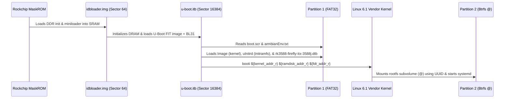

# Architecture & Partition Layout: Firefly ITX-3588J

## System Overview

The **Firefly ITX-3588J** is an industrial Mini-ITX motherboard powered by the **Rockchip RK3588** octa-core SoC:
- **CPU**: 4x Cortex-A76 cores (up to 2.4 GHz) + 4x Cortex-A55 cores (up to 1.8 GHz)
- **GPU**: ARM Mali-G610 MP4 (Valhall 3rd gen, ~450 GFLOPS)
- **NPU**: 6.0 TOPS Neural Processing Unit
- **Display**: VOP2 engine driving dual HDMI 2.1 (8K@60 / 4K@120), DisplayPort over USB-C, and VGA
- **Storage**: On-board eMMC (256 GB), M.2 SATA/NVMe slot (up to 4x PCIe 3.0), and 4x SATA 3.0 ports
- **Networking**: Dual Gigabit Ethernet (Realtek RTL8211F)

---

## Storage & Partition Map

Rockchip RK3588 boot architecture relies on specific sector offsets in the boot storage device. The GPT partition table is constructed to leave the initial 16 MiB completely unpartitioned for U-Boot stage 1 and stage 2 loaders:

```text
Sector 0:       Protective MBR & Primary GPT Header
Sectors 1-63:   GPT Partition Table Entries
Sector 64:      idbloader.img (Rockchip DDR init + Miniloader / TPL+SPL) [32 KB offset]
Sector 16384:   u-boot.itb (FIT image: Das U-Boot proper + ARM Trusted Firmware BL31) [8 MB offset]
Sector 32768:   Start of Partition 1 (16 MiB offset)
```

### Partition Scheme

| Part | Name | Type | Size | Filesystem | Mount Point | Mount Options |
|---|---|---|---|---|---|---|
| `p1` | `BOOT` | `0700` (Basic Data/ESP) | 512 MiB | FAT32 | `/boot` | `defaults,noatime` |
| `p2` | `ROOT` | `8300` (Linux Root) | Remaining | Btrfs | `/` (subvols) | `compress=zstd:3,noatime,discard=async` |

### Btrfs Subvolume Topology

Partition 2 uses standard Arch/Omarchy Btrfs subvolumes for snapshotting and rollback protection:

```text
ROOT (Btrfs Partition)
├── @                  -> / (Root filesystem)
├── @home              -> /home (User home directories)
├── @snapshots         -> /.snapshots (Snapper / system restore points)
├── @var_log           -> /var/log (Systemd journals and logs)
└── @pkg               -> /var/cache/pacman/pkg (Pacman package cache; nodatacow)
```

---

## Boot Chain Execution Flow


